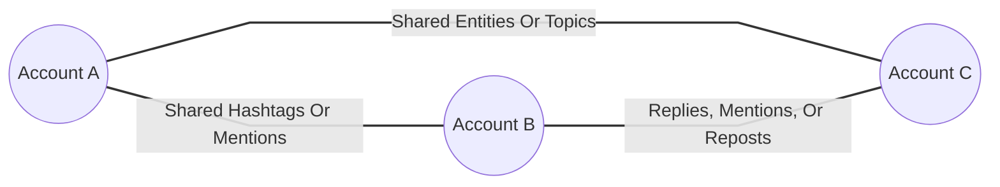
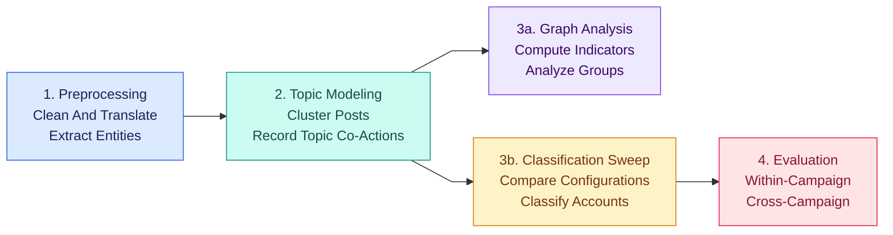

<p align="center">
  
</p>

# I Can See U (ICSU)

**Indicator-Based Detection Of Information Operations And Topic-Aware Group Analysis**

This repository contains the research
pipeline for I Can See U. It detects social media accounts involved in information
operations (IO) using interpretable indicators derived from behavioral similarity
graphs and posting topics. It also supports group analysis to investigate which
accounts act together and the narratives they promote.

## Authors

**Amit Ner Gaon, Noa Tal, Idan Mualle and Rami Puzis**

Stein Faculty of Computer and Information Science and Cyber@BGU,<br/>
Ben-Gurion University of the Negev,<br/>
Beer-Sheva, Israel

## Conference

Published as a full paper at [Complex Networks 2026](https://complexnetworks.org/).


## Paper And Presentation

- [Research Paper (PDF)](docs/I%20Can%20See%20You%20paper.pdf)
- [Presentation (PowerPoint)](docs/I_Can_See_U_presentation.pptx)

## Project Goal And Approach

The project studies how observable coordination and network structure help
identify IO accounts and explain their collective activity. Its main questions are:

1. Which account relations are most useful for constructing co-action graphs?
2. How well do interpretable indicators identify IO accounts within a campaign
   and generalize to an unseen campaign?
3. Can groups extracted from these graphs reveal additional IO accounts and
   their shared topics?

The pipeline enriches posts, discovers topics, builds account graphs, computes
account indicators, and evaluates classifiers. Classifiers receive numeric
indicators; text and embeddings are used upstream for enrichment and topic
modeling. Group analysis then combines structural groups with topic information
for human interpretation.

### Graphs And Indicators

A **co-action graph** models a social network through relations relevant to IO
classification. Nodes represent accounts, and weighted, undirected edges encode
time-bounded shared behavior or direct interactions. Repeated relations increase
edge weights; self-loops are excluded.



This illustrative graph connects accounts through observable activity.
Shared behavior is measured within 12-hour and three-day windows; direct
interactions have no temporal restriction. Structural indicators, such as
centrality and core number, and topic indicators, such as posting dominance and
TF-IDF-based key scores, characterize accounts for IO classification.

## Results

The paper evaluates six Twitter campaigns: **China-1, Cuba, Iran-1, Russia-1,
UAE, and Venezuela**. Platform-labeled IO accounts are compared with controls
selected using shared hashtags and posting dates.

The following are the mean scores across the six campaigns from Table 3 of the
paper. They summarize the paper's experiments, rather than a new execution of
this repository.

| Evaluation Setting | Classifier | ROC-AUC | PR-AUC |
|---|---|---:|---:|
| Within-campaign, 80% labeled training accounts | Random Forest | 0.990 | 0.973 |
| Within-campaign, 80% labeled training accounts | XGBoost | 0.993 | 0.973 |
| Cross-campaign, leave one campaign out | Random Forest | 0.933 | 0.723 |
| Cross-campaign, leave one campaign out | XGBoost | 0.926 | 0.679 |

Within-campaign evaluation is **transductive**: the complete campaign graph is
available, while training and test account labels are separated. Cross-campaign
evaluation trains on five campaigns and tests on the sixth. Numeric features
are normalized within each complete campaign; campaign-specific community and
topic identifiers are excluded from that evaluation.

The main findings are:

- Shared behavioral and text-derived relations are more informative than direct
  interactions alone. Adding text-derived relations provides a modest improvement.
- Core number has the highest mean information gain, followed by Louvain
  community and degree centrality.
- K-core components and direct neighborhoods support useful group analysis.
  K-core groups offer a balance between IO-account concentration and topic
  alignment. An Iran-1 case study identified a maximum-k-core component of
  312 accounts, all labeled as IO accounts.

These findings depend on the evaluated historical campaigns and their control
sampling. Translation, named entity recognition, and topic inference can
introduce errors, and performance varies across held-out campaigns.

## Repository Layout

```text
Backbone-Graph/
├── config/
│   ├── conda_requirements.yml          Environment specification
│   ├── run_*.sbatch                   Slurm jobs, including classification sweeps
│   ├── run_full_pipeline.sh           Pipeline submission and dependencies
│   └── *.md                           Environment and cluster usage notes
├── data/
│   └── Labeled_Datasets/<campaign>/
│       └── *_part_all.gzip.parquet    Campaign input data
├── docs/
│   ├── I Can See You paper.pdf        Research paper
│   ├── I_Can_See_U_presentation.pptx   Presentation
│   └── i_can_see_u_logo*.png          Project logos
├── src/
│   ├── 1_translate_topics_entities.ipynb    Preprocessing and enrichment
│   ├── 2_BERTopic_clustering.ipynb          Topic clustering
│   ├── 3_key_authors_graph.ipynb            Graphs, indicators, and group analysis
│   ├── 3_classification_sweep.ipynb         Classification sweep worker
│   └── 4_inter_intra_classification.ipynb   Within- and cross-campaign evaluation
├── results/Labeled_Datasets/
│   ├── <campaign>/<part>/
│   │   ├── step_1_translate_topics_entities/   Enriched data and checkpoints
│   │   ├── step_2_BERTopic_clustering/         Combined data and topic models
│   │   │   └── topic_col_BERTopic_topic_<size>/
│   │   └── step_3_key_authors_graph/
│   │       ├── topic_col_*/           GraphML, indicators, and analysis outputs
│   │       └── classification_sweep/
│   │           ├── *_results.csv     Classification metrics
│   │           └── classification_sweep_indicators/
│   │               └── all_authors/  Account-indicator Parquet files
│   └── step_4_inter_intra_classification/
│       └── <campaign_group>/.../      Evaluation tables and figures
├── logs/                             Executed notebooks and Slurm logs
└── README.md                         Project overview and run instructions
```

The tree summarizes the principal files and generated outputs; available
result folders depend on completed stages. Large datasets, model
artifacts, and some outputs are ignored by Git. Prepare the input data locally
and create `logs/` before submitting jobs.

## Code Steps

Run the notebooks with **`src/` as the working directory**. This is required by
the relative paths in the early stages and the batch scripts.



| Step | Implementation |
|---|---|
| 1 | [1_translate_topics_entities.ipynb](src/1_translate_topics_entities.ipynb) |
| 2 | [2_BERTopic_clustering.ipynb](src/2_BERTopic_clustering.ipynb) |
| 3a | [3_key_authors_graph.ipynb](src/3_key_authors_graph.ipynb) |
| 3b | [3_classification_sweep.ipynb](src/3_classification_sweep.ipynb) |
| 4 | [4_inter_intra_classification.ipynb](src/4_inter_intra_classification.ipynb) |

Within Step 3, graph analysis and the classification sweep both consume Step 2
output. `3_classification_sweep.ipynb` **serves only to parallelize the Step 3**
classification work across different configurations, reusing the implementation
in `3_key_authors_graph.ipynb`. Each task processes one topic/relation
configuration and compares indicator sets using Random Forest, XGBoost, and
Logistic Regression. Step 4 requires matching
sweep outputs for every selected campaign and includes a separate 60/20/20
train/validation/test experiment for baseline comparisons.

### Important Settings

| Notebook | Settings To Review |
|---|---|
| Step 1 | `input_data_path`, `is_test`, batch sizes, and `force_restart`. Compatible checkpoints resume automatically; `force_restart=True` discards existing Step 1 progress. |
| Step 2 | `input_data_path`, `min_topic_sizes`, `chunk_size`, and `transform_batch_size`. The notebook defaults to `[256]`; the full-pipeline launcher uses `[10, 128, 256, 512]`. |
| Step 3 graph analysis | `input_data_path`, `topic_col`, and `account_relations`. `run_demo=True` enables the main analysis; temporal analysis has a separate flag. |
| Step 3 sweep worker | `input_data_path`, `classification_task_id`, and `models`. Each task processes one topic/relation configuration. |
| Step 4 | `CAMPAIGNS`, `topic_method`, `edge_types`, `FRACTIONS`, and `MODELS`. The selected configuration must match existing sweep outputs. |

Some settings are defined outside Papermill's tagged parameter cells; review
those cells directly when changing the analysis configuration.

## Input Data

The experiments use [Labeled Datasets for Research on Information Operations](https://zenodo.org/records/14189193).
Use Parquet inputs with the column names expected by the notebooks. The standard
campaign layout is:

```text
data/Labeled_Datasets/<campaign>/<campaign>_part_all.gzip.parquet
```

Directory names used by Step 4 are `China_1`, `Cuba`, `Iran_1`, `Russia_1`,
`UAE`, and `Venezuela`. The pipeline launcher accepts the campaign directory name
as its argument.

| Columns | Purpose |
|---|---|
| `postid`, `accountid`, `post_time` | Post identity, author identity, and timestamp. |
| `post_text`, `post_language` | Text processing and translation. |
| `is_control` | Ground truth: `True`/`1` means control, `False`/`0` means IO. |
| `hashtags`, `account_mentions`, `urls` | Entity lists used during enrichment. |
| `in_reply_to_accountid`, `reposted_accountid` | Required when using direct-interaction relations. |
| `is_repost`, `reposted_postid` | Additional fields required by the graph notebook's demo and repost analyses. |

List-valued columns can be stored as JSON arrays. Later stages load generated
entity-reuse columns, topic assignments, and same-topic account relations from
the enriched data. Exported sweep indicator files use `io_drive_label=1` for IO
accounts, which is the opposite polarity of the input `is_control` flag.

## How To Run

Use the Linux/CUDA environment `i_can_see_u_env` defined in
`config/conda_requirements.yml`.  
See [config/config_README.md](config/config_README.md) for environment setup and
Papermill usage, and [config/slurm_commends.md](config/slurm_commends.md) for
BGU HPC submission commands.  
**Run Steps 1-3 for each campaign before Step 4.**

## Additional Implementation: Filtering Outside The Paper

The notebooks retain exploratory filtering procedures that are **not part of
this paper**. They restrict account graphs using topic-based key scores,
core-number rankings, or sequential combinations of the two, allowing analysis
of smaller account subsets. Author selection uses `top_percentage`
(`top_percentages` in the sweep worker) on a 1-100 scale; `100` retains all
accounts. For the paper's workflow, retain `top_percentage=100`,
`top_percentages=[100]`, `graph_filtering_setting="all_authors"`, and
`run_graph_filtering=False`.
